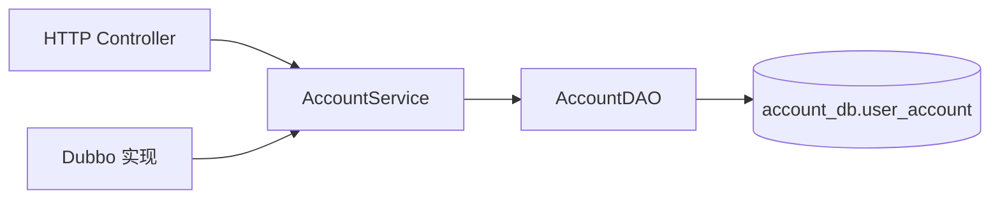

# Account Service · 账号应用

提供账号资料查询、更新和删除，通过 HTTP 与 Dubbo 两种入口复用同一套业务逻辑。

[项目结构](#项目结构) · [快速开始](#快速开始) · [HTTP 接口](#http-接口) · [Dubbo 接口](#dubbo-接口) · [配置](#配置) · [测试](#测试)

## 项目结构

```text
account-service/
├── pom.xml                         account-parent：模块组织、依赖版本
├── account-api/
│   └── src/main/
│       ├── java/com/murto/account/api/
│       │   ├── AccountQueryService.java
│       │   ├── dto/                共享请求、响应模型
│       │   └── exception/          共享业务异常
│       └── resources/security/serialize.allowlist
└── account-server/
    └── src/
        ├── main/java/com/murto/account/
        │   ├── AccountServiceApplication.java
        │   ├── controller/         HTTP 入口和异常转换
        │   ├── service/            业务逻辑、Dubbo 实现
        │   └── dao/                JDBC 数据访问
        ├── main/resources/application.properties
        └── test/java/              启动、HTTP、RPC 测试
```



`account-api` 是供其他应用依赖的普通 JAR，没有启动入口；`account-server` 是独立运行的 Spring Boot 应用。

## 快速开始

### 环境

| 项目 | 版本 / 默认值 |
| --- | --- |
| JDK | 21 |
| Maven | 3.9.x，可使用 IDEA 自带 Maven |
| Spring Boot | 3.5.16 |
| Dubbo | 3.3.6 |
| MySQL | 本地练习使用 8.4，端口 3306 |
| ZooKeeper | 本地练习使用 3.9.7，端口 2181 |
| HTTP / Dubbo 端口 | 8081 / 20882 |

### 初始化与启动

1. 启动 MySQL、ZooKeeper。
2. 按[数据库说明](../datas/database/README.md)执行建表和演示数据脚本。账号表为 `account_db.user_account`。
3. 在 IDEA 打开本目录的父 `pom.xml`，刷新 Maven。
4. 运行 `account-server` 内的 `com.murto.account.AccountServiceApplication`。

如果已配置 `mvn` 命令，也可以在本目录执行：

```bash
# 将父 POM、API JAR 安装到本机仓库，供子模块和其他应用引用
mvn -DskipTests install

# 启动应用
mvn -pl account-server spring-boot:run
```

这里的 `-DskipTests` 仅用于快速构建，不代表已经通过测试。IDEA 用户可在父模块 Maven 面板执行同样的生命周期目标。

## HTTP 接口

| 方法 | 路径 | 作用 | 成功状态 |
| --- | --- | --- | --- |
| GET | `/accounts/{userId}` | 查询账号资料 | 200 |
| GET | `/accounts/info?userId=1` | 兼容学习入口，省略 userId 时默认 1 | 200 |
| PUT | `/accounts/{userId}` | 更新昵称、头像 | 200 |
| DELETE | `/accounts/{userId}` | 物理删除账号 | 204 |

### 查询

```bash
curl 'http://localhost:8081/accounts/1'
```

响应示例，ID 和时间以实际数据为准：

```json
{
  "id": 1,
  "loginName": "demo_murto",
  "nickname": "Murto",
  "avatarUrl": null,
  "status": 0,
  "createdAt": "2026-11-23T21:19:29",
  "updatedAt": "2026-11-23T21:19:29"
}
```

### 更新

```bash
curl -i -X PUT 'http://localhost:8081/accounts/1' \
  -H 'Content-Type: application/json' \
  -d '{
    "nickname": "新昵称",
    "avatarUrl": null
  }'
```

- `nickname` 必填，去除首尾空白后最多 100 个 Unicode 码点。
- `avatarUrl` 最多 1000 个 Unicode 码点；`null` 或省略表示清空。
- 更新返回完整账号资料，重复提交相同内容仍正常返回。
- 此接口只修改资料，不修改登录名、密码、账号状态或创建时间。

### 删除与错误

```bash
# 此请求会实际删除指定账号
curl -i -X DELETE 'http://localhost:8081/accounts/1'
```

非法业务参数返回 400，账号不存在返回 404；重复删除同一账号也返回 404。业务错误的响应体包含 `message`。账号响应不包含 `password_hash`。

## Dubbo 接口

契约：[AccountQueryService.java](account-api/src/main/java/com/murto/account/api/AccountQueryService.java)。

```java
AccountInfo queryAccount(Long userId);

AccountInfo updateAccount(Long userId, UpdateAccountRequest request);

boolean deleteAccount(Long userId);
```

查询、更新返回 `AccountInfo`；删除成功返回 `true`。账号不存在抛出共享的 `AccountNotFoundException`，参数非法抛出 `IllegalArgumentException`。异常类型和 DTO 随 API JAR 一同提供；精确异常白名单位于 `security/serialize.allowlist`。

调用方加入依赖：

```xml
<dependency>
    <groupId>com.murto</groupId>
    <artifactId>account-api</artifactId>
    <version>1.0.0-SNAPSHOT</version>
</dependency>
```

调用方还需启用 Dubbo、添加相应 Starter 并连接同一注册中心：

```java
@DubboReference(timeout = 3000, retries = 0)
private AccountQueryService accountQueryService;
```

## 配置

配置文件：[application.properties](account-server/src/main/resources/application.properties)。

| 配置 / 环境变量 | 默认值 | 说明 |
| --- | --- | --- |
| `server.port` | `8081` | HTTP 端口 |
| `ACCOUNT_DUBBO_PORT` | `20882` | Dubbo 端口 |
| `DUBBO_REGISTRY_ADDRESS` | `zookeeper://127.0.0.1:2181` | 注册中心 |
| `ACCOUNT_DB_URL` | `jdbc:mysql://127.0.0.1:3306/account_db` | 数据库地址 |
| `DB_USERNAME` | `root` | 数据库用户 |
| `DB_PASSWORD` | 空 | 数据库密码 |

演示数据中 `demo_murto` 账号被禁用且没有可用密码，仅用于资料操作。本应用尚未实现注册、登录、调用方鉴权及跨应用级联删除。

## 测试

在本目录执行普通启动测试：

```bash
mvn test
```

启动测试使用 `N/A` 注册中心和动态 Dubbo 端口，避免与运行中的服务争抢端口。数据库集成测试默认跳过，显式启用：

```bash
RUN_DB_TESTS=true mvn \
  -Dtest=AccountApiDatabaseTest,AccountDubboDatabaseTest \
  -Dsurefire.failIfNoSpecifiedTests=false test
```

- HTTP 测试通过 MockMvc 和真实 MySQL 验证接口，测试数据在事务结束时回滚。
- RPC 测试强制网络调用，使用临时端口 `30882`，结束时清理独立测试账号并关闭测试应用。
- 测试覆盖资料更新、查询、删除、参数错误及账号不存在。
- HTTP 测试连接可用 `TEST_ACCOUNT_DB_URL` 覆盖，账号密码使用 `DB_USERNAME`、`DB_PASSWORD`。

## 相关应用

[店铺](../shop-service/README.md) · [商品](../goods-service/README.md) · [网关](../gateway-service/README.md)

## 学习复习

[Java 后端开发复习手册](../docs/backend-learning/README.md)按章节解释本项目涉及的 HTTP、Maven、分层、Dubbo、数据库和并发知识。
