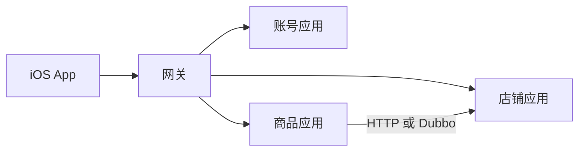

# 第一章 从 iOS 理解后端应用

## 学习目标

- 区分语言、框架、工程、模块、应用和运行实例。
- 理解后端在 iOS 请求链路中的职责。
- 画出当前四个应用组成的系统。

## 核心概念

后端应用是运行在服务器或本机上的程序，接收请求、执行业务、访问数据，再返回结果。本地开发时，Mac 就是服务器；运行服务不要求先购买云服务器或域名。

Java 是语言，Spring Boot 是可选的应用框架。Java 程序可以是命令行工具、桌面程序或后端服务，Java 后端也不一定使用 Spring Boot。企业项目通常将应用框架、RPC、数据库访问、监控等组件组合使用。

| 概念 | 当前例子 | iOS 类比 |
| --- | --- | --- |
| 语言 | Java | Swift |
| 应用框架 | Spring Boot | UIKit、SwiftUI 的部分职责 |
| 工程 | Maven 工程 | Xcode 工程 |
| 可复用模块 | account-api | 内部 Pod、Package Target |
| 应用进程 | 已启动的 shop-server | 运行中的 App 进程 |
| 多个实例 | 同一个店铺程序启动多份 | 同一套程序运行在不同设备或进程中 |

这些是职责类比，不是底层机制的一一对应。

## 应用内部与系统之间的两层结构

```text
后端系统
├── gateway-service     客户端统一 HTTP 入口
├── account-service     账号资料
├── shop-service        店铺业务
└── goods-service       商品业务
```

每个应用内部又可以分为 Controller、Service、DAO 等。业务应用之间通过网络协作，而不是因为在同一个 IDEA 窗口中就变成本地调用。



一个业务应用可以包含很多功能，也可以因团队和业务边界拆成多个应用。代码在一个仓库还是多个仓库，与是否独立部署是两个问题。

## 项目对照

| 应用 | HTTP 端口 | RPC 角色 | 数据库 |
| --- | --- | --- | --- |
| gateway-service | 8080 | 不直接参与 Dubbo | 无 |
| account-service | 8081 | 提供 Dubbo，端口 20882 | account_db |
| shop-service | 8082 | 提供 Dubbo，端口 20881 | shop_db |
| goods-service | 8083 | 调用店铺 Dubbo | goods_db |

账号和店铺各自是多 Maven 模块工程，但每个仍只启动一个业务应用。ZooKeeper、MySQL 是另外两个独立服务程序。

## 复习练习

不看代码，分别画出“查询账号”“查询真实商品列表”“商品通过 Dubbo 查询店铺”的链路。注意真实商品列表直接查询 goods_db，不需要远程调用店铺。

## 自测

1. 一个 Spring Boot 工程是否一定对应多个微服务？
2. 一个应用启动三份，是三个不同应用还是三个实例？
3. Java、Spring Boot、Dubbo、MySQL 分别解决什么问题？

答案见[复习自测答案](review-answers.md#第一章)。

## 代码入口

[账号说明](../../account-service/README.md) · [店铺说明](../../shop-service/README.md) · [商品说明](../../goods-service/README.md) · [网关说明](../../gateway-service/README.md)
