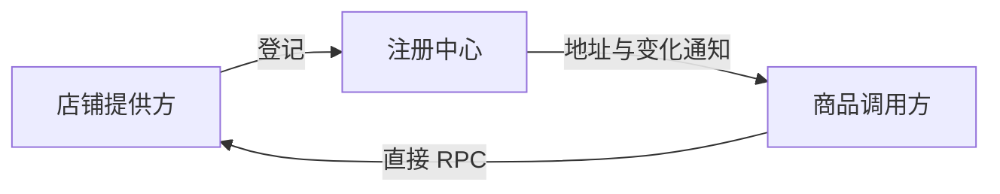

# 第八章 注册中心与 ZooKeeper

## 学习目标

- 理解注册中心负责地址发现而不是业务转发。
- 看清 ZooKeeper 程序、数据和应用客户端依赖的区别。
- 能查看注册数据，并解释停止注册中心后为什么调用仍可能成功。

## 为什么需要注册中心

固定地址能工作，但服务迁移、多实例和实例上下线后，每个调用方手动维护地址很麻烦。注册中心相当于服务通讯录：提供方登记信息，调用方发现和订阅地址变化。



调用方获得地址列表后，由 Dubbo 的负载均衡机制选择实例。注册中心不替店铺执行业务，也不转发每次商品查询。

## ZooKeeper 是什么

ZooKeeper 是独立 Java 服务程序。下载的 apache-zookeeper-3.9.7-bin 是发行包，bin 是脚本、conf 是配置、lib 是程序依赖。启动脚本会创建 Java 进程并监听客户端端口。

运行数据存在哪里由 conf/zoo.cfg 的 dataDir 决定，不一定在程序目录内。迁移程序目录时，不能遗漏数据目录和绝对路径配置。

```properties
tickTime=2000
dataDir=../../datas/zookeeper-data
clientPort=2181
admin.enableServer=false
```

关闭管理 HTTP 服务可避免它的默认端口与我们网关的 8080 冲突。

## 为什么只改依赖和配置就能工作

```properties
dubbo.registry.address=zookeeper://127.0.0.1:2181
```

ZooKeeper 接入依赖提供客户端实现；Dubbo 根据地址协议选择实现，扫描服务与引用，完成登记、订阅和远程代理初始化。代码没有消失，而是在框架中执行。

提供方与调用方都需要对应的 ZooKeeper 接入组件。当前使用 dubbo-zookeeper-curator5-spring-boot-starter:3.3.6。切换发现方式时必须移除旧直连 url，否则调用仍可能使用固定地址。

## 查看注册数据

在 ZooKeeper 程序目录执行：

```bash
bin/zkCli.sh -server 127.0.0.1:2181
```

连接成功后，下列是客户端中的命令：

```text
ls /
ls /services
ls /services/shop-service
ls -R /services/shop-service
```

用 get 加实际实例节点的完整路径读取内容。Dubbo 的应用级登记通常在 /services/应用名，接口级登记还可能在 /dubbo/完整接口名/providers；具体以当前 ls 结果和注册模式为准。节点数据会包含地址、端口、元数据等，不是数据库里的店铺记录。

quit 只退出命令行客户端，不停止服务端。

## 停止后为什么还能调用

Dubbo 调用方可能已缓存服务地址并建立连接。停止 ZooKeeper 不会停止店铺进程，所以旧连接和已知地址可能继续可用。

真正受影响的是服务变更发现。旧实例消失、新实例改端口后，调用方可能无法获得更新。重新启动调用方也不保证立即失败，因为还可能读取磁盘缓存，行为取决于配置和缓存状态。

## 企业项目对照

我们查看的 wsc-app-gateway 仓库中，配置使用 haunt 注册协议，文档和环境地址涉及 etcd，并有 haunt-agent 配置。这说明它接入了公司封装的注册发现体系，不能据此推断当前公司所有应用都使用同一实现。服务登记和地址发现的基础概念仍相通。

## 复习练习

只读查看 /services 下的节点；在确认所有调用均为演示后，可以停止 ZooKeeper 并保留店铺、商品进程，再观察旧调用是否继续成功。实验结束恢复注册中心。

## 自测

1. 注册中心与网关在业务请求路径上的区别是什么？
2. 停止 ZooKeeper 后还能查询店铺，是否说明配置没有生效？
3. ZooKeeper 发行包目录与 dataDir 是否一定是同一个目录？

答案见[复习自测答案](review-answers.md#第八章)。

## 代码入口

[店铺配置](../../shop-service/shop-server/src/main/resources/application.properties) · [账号配置](../../account-service/account-server/src/main/resources/application.properties)
