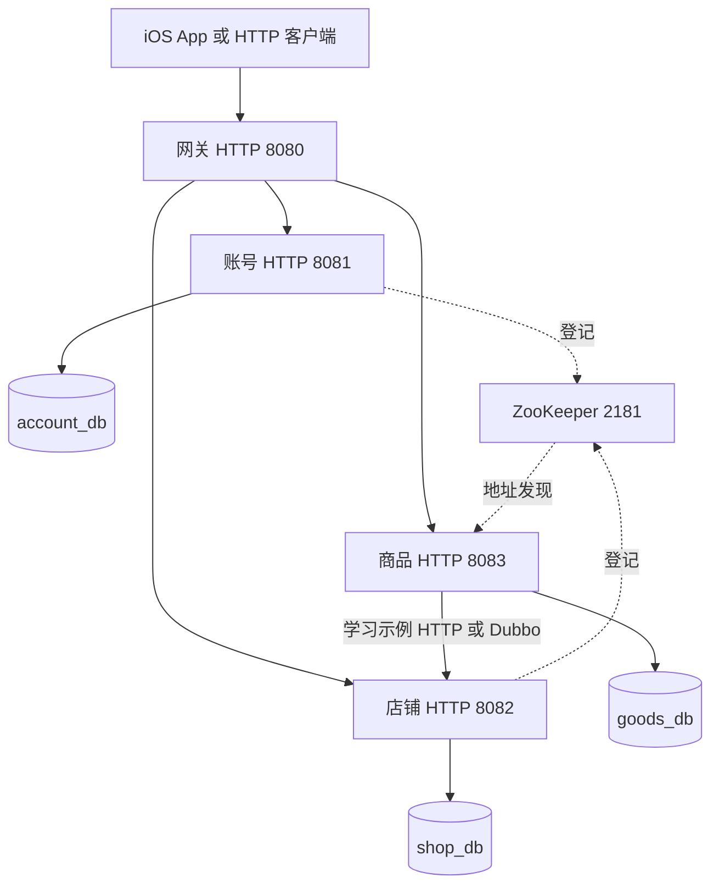

# Java 后端开发复习手册

这套手册面向已有 iOS 开发经验、正在学习 Java 后端的开发者。以当前账号、店铺、商品、网关 Demo 为线索，从请求如何进入应用，一直讲到跨服务调用、数据库、并发和本地排错。

复习时先理解各层负责什么，再追踪一次请求经过哪些对象、进程和数据源。工程能跑通说明某条路径有效；接口契约、异常和并发行为仍需要分别理解与验证。

## 阅读方式

- **第一次复习**：按章节顺序阅读，每章先看学习目标，再对照代码完成小练习。
- **按问题查阅**：使用下方章节表与概念速查。
- **检查是否理解**：先口头回答章末三道题，再看[自测答案](review-answers.md)。
- **重新运行项目**：使用各应用 README 的当前启动步骤，概念章节中的精简代码仅用于说明原理。

每章包含学习目标、概念解释、Demo 对照、复习练习、自测和代码入口。文档按 2026 年 11 月 24 日的工程整理；后续修改接口或目录时，应同步维护相应链接与约定。

## 章节目录

| 章节                                                       | 学习目标                                 | 学完应能完成的事                     |
| -------------------------------------------------------- | ------------------------------------ | ---------------------------- |
| [第一章 从 iOS 理解后端应用](01-backend-overview.md)               | 分清语言、框架、应用、模块、实例                     | 画出四个应用与 MySQL、ZooKeeper 的关系  |
| [第二章 启动 Spring Boot 并理解 HTTP 接口](02-spring-boot-http.md) | 理解工程生成、URL、参数与注解                     | 说明 GET 和 POST 请求如何进入 Java 方法 |
| [第三章 工程分层与依赖注入](03-layers-and-dependency-injection.md)   | 理解 Controller、Service、DAO、Client、DTO | 解释对象为什么通过构造器传入               |
| [第四章 Maven 依赖 模块与构建](04-maven-and-modules.md)            | 理解 POM、JAR、父子模块和生命周期                 | 区分运行 main、package、install    |
| [第五章 网关路由与统一入口](05-gateway.md)                           | 理解配置驱动的 HTTP 转发                      | 判断请求由哪个下游处理                  |
| [第六章 应用之间通过 HTTP 调用](06-http-service-calls.md)           | 理解后端客户端与响应转换                         | 跟踪商品通过 RestClient 查询店铺       |
| [第七章 Dubbo 契约与远程代理](07-dubbo.md)                         | 理解 API JAR、提供方、调用方                   | 解释看似本地方法为何实际经过网络             |
| [第八章 注册中心与 ZooKeeper](08-registry-zookeeper.md)          | 理解服务登记、发现、缓存                         | 查看服务节点并解释注册中心停机现象            |
| [第九章 MySQL 表与 Java 数据访问](09-mysql-and-jdbc.md)           | 理解数据库、连接、SQL、模型映射                    | 追踪一条记录如何变为 JSON              |
| [第十章 创建 更新 删除与业务表设计](10-crud-and-data-models.md)         | 理解 CRUD、模型边界与表关联                     | 解释用户 ID、登录名、商品归属及字段权限        |
| [第十一章 并发 事务 连接池与查询性能](11-concurrency-and-performance.md) | 分清线程、连接、事务与业务冲突                      | 解释连接池耗尽、慢查询和分页               |
| [第十二章 本地运行 排错与目录迁移](12-operations-and-debugging.md)      | 建立逐层定位问题的方法                          | 检查端口、读测试报告、迁移配置              |

## 系统总览



虚线表示注册发现，不表示业务请求转发。Dubbo 当前账号端口为 20882，店铺端口为 20881；MySQL 服务端口为 3306。所有逻辑数据库可以位于同一个本机 MySQL 实例。

## 当前工程与能力

```text
backend/
├── account-service/
│   ├── account-api/       共享接口、模型、业务异常
│   └── account-server/    HTTP、Dubbo、业务、数据库访问
├── shop-service/
│   ├── shop-api/          共享店铺接口和模型
│   └── shop-server/       HTTP、Dubbo、业务、数据库访问
├── goods-service/         商品列表、店铺 HTTP 和 Dubbo 客户端
├── gateway-service/       HTTP 路由网关
├── datas/database/        三个业务库的建表、演示数据脚本
└── docs/backend-learning/ 本复习手册
```

| 能力 | 当前状态 |
| --- | --- |
| 账号查询、资料更新、删除 | 已实现 HTTP 与 Dubbo |
| 店铺创建、查询 | 已实现 HTTP 与 Dubbo |
| 店铺更新、删除 | 已实现 Dubbo，未开放对应 HTTP 入口 |
| 指定店铺商品分页列表 | 已实现 HTTP 和真实数据库查询 |
| 网关按路径转发 | 已实现，使用固定 HTTP 下游地址 |
| 通过 ZooKeeper 发现店铺服务 | 已实现，替换了最初的固定 RPC 地址 |
| 账号注册、登录、Token、权限验证 | 未实现，演示账号不可登录 |
| 账号与店铺归属关系 | 讨论过，现有 shop 表尚无 owner_user_id |
| 商品创建、订单、支付、库存扣减 | 未实现 |
| 乐观锁、分库分表、消息队列、ORM | 讨论过或后续主题，未接入 |

/goods/info、/goods/info_v2 是历史学习入口，不是数据库真实商品详情。当前新列表使用 /goods/list。不要将早期讲解中的 /goods/info-dubbo 当作当前工程接口。

## 三条贯穿链路

### 查询真实商品列表

```text
客户端 → 网关 → GoodsListController → GoodsService → GoodsDAO → goods_db
```

### 商品示例通过 Dubbo 查店铺

```text
客户端 → 网关 → GoodsController → ShopDubboClient
    → 店铺 RPC 入口 → ShopService → ShopDAO → shop_db
```

### 修改账号资料

```text
客户端 PUT → 网关 → AccountController → AccountService
    → AccountDAO UPDATE 与回查 → account_db → AccountInfo → JSON
```

第一次复习时，任选一条链路，在 IDE 中打开每一层方法，能说出数据和错误在哪里转换，就已建立整体认识。

## 概念速查

| 我想回顾 | 阅读位置 |
| --- | --- |
| Spring Boot 与 Java 的关系 | [第一章](01-backend-overview.md) |
| 包名、Package 菜单、请求参数 | [第二章](02-spring-boot-http.md) |
| 为什么构造器传入依赖 | [第三章](03-layers-and-dependency-injection.md) |
| API JAR 与共享实现库的区别 | [第四章](04-maven-and-modules.md) |
| 为什么网关不用手写转发代码 | [第五章](05-gateway.md) |
| RestClient 与 URLSession 的类比 | [第六章](06-http-service-calls.md) |
| Dubbo 模型、异常、接口升级 | [第七章](07-dubbo.md) |
| 注册中心停止后为什么还能调用 | [第八章](08-registry-zookeeper.md) |
| MySQL 与 DBeaver 是什么关系 | [第九章](09-mysql-and-jdbc.md) |
| user_id、id、login_name、数据库自动生成 | [第九章](09-mysql-and-jdbc.md)、[第十章](10-crud-and-data-models.md) |
| 表很大、SQL 慢、线程和连接池 | [第十一章](11-concurrency-and-performance.md) |
| 启动失败、404、迁移目录 | [第十二章](12-operations-and-debugging.md) |

## 操作手册

- [账号应用 README](../../account-service/README.md)
- [店铺应用 README](../../shop-service/README.md)
- [商品应用 README](../../goods-service/README.md)
- [网关应用 README](../../gateway-service/README.md)
- [数据库初始化说明](../../datas/database/README.md)

本手册使用项目内相对链接，整体迁移 Demo 后仍可导航；外部程序路径、ZooKeeper dataDir 与 IDE 运行配置仍需按迁移后的环境更新。

## 后续学习路线

先完成基础 CRUD 与 iOS 真实调用的闭环，再依次学习注册登录、资源权限、统一错误响应、事务与并发冲突测试。缓存、消息队列和分片应围绕实际问题引入，不要求先堆齐基础设施。
