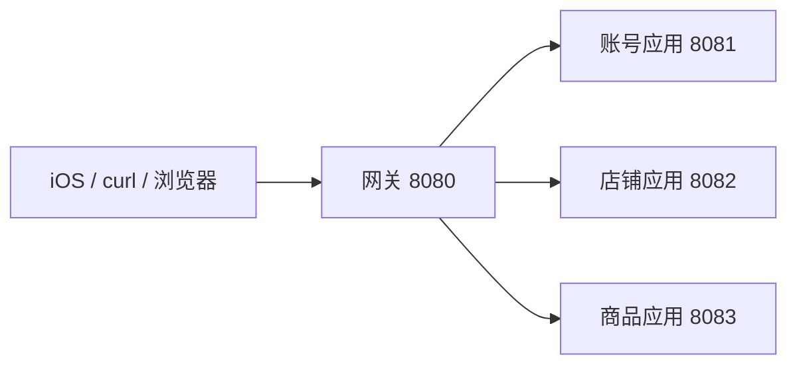

# Gateway Service · 网关应用

为客户端提供统一 HTTP 入口，根据请求路径将流量转发到账号、店铺、商品应用，并将下游响应返回客户端。

[路由规则](#路由规则) · [项目结构](#项目结构) · [快速开始](#快速开始) · [调用示例](#调用示例) · [配置](#配置) · [测试与排查](#测试与排查)

## 路由规则

| 路由 ID | 匹配路径 | 下游地址 |
| --- | --- | --- |
| `account-route` | `/accounts/**` | `http://localhost:8081` |
| `shop-route` | `/shop/**` | `http://localhost:8082` |
| `goods-route` | `/goods/**` | `http://localhost:8083` |



请求方法、路径、查询参数和请求体由 Gateway 转发。例如 `POST /shop/create` 会发往店铺应用相同路径。当前未配置路径前缀删除或重写，网关也不会把下游的错误自动转换为成功。

## 项目结构

```text
gateway-service/
├── pom.xml                              Gateway 依赖、Spring Cloud BOM
└── src/
    ├── main/java/com/murto/gateway/
    │   └── GatewayServiceApplication.java
    ├── main/resources/application.properties
    └── test/java/                        启动测试
```

转发由 Spring Cloud Gateway 完成，无需为每个业务路径编写 Controller。网关不保存账号、店铺和商品数据，也不直接连接数据库或 Dubbo 注册中心。

## 快速开始

### 环境

| 项目 | 版本 / 默认值 |
| --- | --- |
| JDK / Maven | 21 / 3.9.x，可使用 IDEA 自带 Maven |
| Spring Boot | 4.1.3 |
| Spring Cloud | 2025.1.2 |
| 网关实现 | Spring Cloud Gateway Server WebFlux |
| HTTP 端口 | 8080 |

### 启动顺序

完整联调建议依次启动：

1. MySQL、ZooKeeper。
2. [店铺应用](../shop-service/README.md)、[账号应用](../account-service/README.md)。
3. [商品应用](../goods-service/README.md)。
4. 网关应用。

网关自身可以独立启动，但相应下游没有运行时，转发请求会失败。只测试某一路由时，不需要所有其他下游都在线。

在 IDEA 打开本目录 `pom.xml`，刷新 Maven，运行 `com.murto.gateway.GatewayServiceApplication`。

如果已配置 `mvn`，可在本目录执行：

```bash
mvn -DskipTests package
mvn spring-boot:run
```

## 调用示例

### 查询账号

```bash
curl 'http://localhost:8080/accounts/1'
```

### 创建店铺

```bash
curl -i -X POST 'http://localhost:8080/shop/create' \
  -H 'Content-Type: application/json' \
  -d '{
    "name": "网关创建的店铺",
    "description": "创建请求经过网关转发",
    "shopType": "PERSONAL"
  }'
```

### 查询店铺商品

```bash
curl 'http://localhost:8080/goods/list?shopId=1&size=20'
```

返回结构、参数规则和状态码由对应业务应用定义：

- [账号 HTTP 接口](../account-service/README.md#http-接口)
- [店铺 HTTP 接口](../shop-service/README.md#http-接口)
- [商品 HTTP 接口](../goods-service/README.md#http-接口)

## 配置

配置文件：[application.properties](src/main/resources/application.properties)。每条路由由三个关键属性组成：

```properties
spring.cloud.gateway.server.webflux.routes[1].id=shop-route
spring.cloud.gateway.server.webflux.routes[1].uri=http://localhost:8082
spring.cloud.gateway.server.webflux.routes[1].predicates[0]=Path=/shop/**
```

| 属性 | 含义 |
| --- | --- |
| `id` | 唯一路由名称 |
| `uri` | 下游 HTTP 地址 |
| `predicates` | 请求匹配条件，这里按路径匹配 |

当前使用固定 HTTP 下游地址，没有接入网关层的动态服务发现、登录鉴权或限流。

监听端口通过 `server.port=8080` 配置，也可用环境变量 `SERVER_PORT` 覆盖。下游地址可用 `ACCOUNT_HTTP_URL`、`SHOP_HTTP_URL`、`GOODS_HTTP_URL` 覆盖。

```bash
mvn spring-boot:run -Dspring-boot.run.arguments=--server.port=8090
```

本项目使用 WebFlux 网关依赖 `spring-cloud-starter-gateway-server-webflux`，不需要再添加 Spring MVC 的 Web Starter。

## 测试与排查

启动上下文测试：

```bash
mvn test
```

这个测试不等于端到端路由验证。完整验证需要运行实际下游，再执行上面的 curl 请求。

| 现象 | 优先检查 |
| --- | --- |
| 浏览器连接被拒绝 | 网关是否启动、访问端口是否正确 |
| 路由返回 404 | 路径是否匹配路由，以及下游是否存在对应接口 |
| 转发出现 5xx / 连接异常 | 下游地址、端口、进程状态及日志 |
| 下游直接访问成功，网关失败 | 网关路由匹配与下游 URI |
| 修改配置后仍走旧规则 | 当前运行的网关是否已重启 |

## 相关应用

[账号](../account-service/README.md) · [店铺](../shop-service/README.md) · [商品](../goods-service/README.md)

## 学习复习

[Java 后端开发复习手册](../docs/backend-learning/README.md)按章节解释本项目涉及的 HTTP、Maven、分层、Dubbo、数据库和并发知识。
