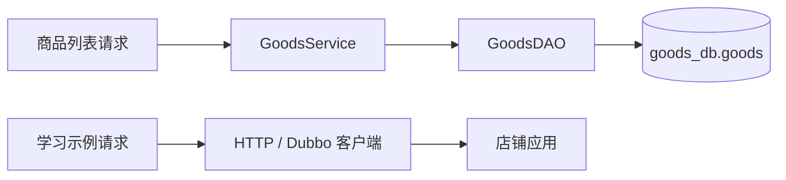

# Goods Service · 商品应用

按店铺查询 MySQL 中的商品列表，同时保留 HTTP、Dubbo 两种店铺调用方式的学习示例。

[项目结构](#项目结构) · [快速开始](#快速开始) · [HTTP 接口](#http-接口) · [分页规则](#分页规则) · [配置](#配置) · [测试](#测试)

## 项目结构

```text
goods-service/
├── pom.xml
└── src/
    ├── main/java/com/murto/goods/
    │   ├── GoodsServiceApplication.java
    │   ├── controller/
    │   │   ├── GoodsListController.java   数据库商品列表
    │   │   └── GoodsController.java       早期跨应用调用示例
    │   ├── service/GoodsService.java      参数校验、分页组装
    │   ├── dao/GoodsDAO.java              商品 SQL 查询
    │   ├── dto/                          商品、分页及店铺模型
    │   └── client/
    │       ├── ShopClient.java           HTTP 调用店铺
    │       └── ShopDubboClient.java      Dubbo 调用店铺
    ├── main/resources/application.properties
    └── test/java/                        数据库集成测试、启动测试
```



商品列表本身直接查询本应用数据库，不调用店铺接口。应用启动时仍会初始化已有的 Dubbo 客户端。

## 快速开始

### 环境

| 项目 | 版本 / 默认值 |
| --- | --- |
| JDK / Maven | 21 / 3.9.x，可使用 IDEA 自带 Maven |
| Spring Boot / Dubbo | 3.5.16 / 3.3.6 |
| HTTP 端口 | 8083 |
| MySQL | 本地练习使用 8.4，端口 3306 |
| ZooKeeper | 本地练习使用 3.9.7，端口 2181 |
| 店铺应用 | HTTP 8082，Dubbo 由注册中心发现 |

### 初始化与启动

1. 按[店铺说明](../shop-service/README.md)构建并安装 `shop-api`，启动店铺服务。
2. 按[数据库说明](../datas/database/README.md)执行 `schema.sql`、`seed.sql`。数据表为 `goods_db.goods`。
3. 在 IDEA 打开本目录 `pom.xml`，刷新 Maven，运行 `com.murto.goods.GoodsServiceApplication`。

如果已配置 `mvn`，可在本目录执行：

```bash
mvn -DskipTests package
mvn spring-boot:run
```

演示数据脚本仅在店铺 1 存在时添加三件商品：两件上架、一件下架。价格按人民币分存储，例如 `1200` 表示 12 元。

## HTTP 接口

| 方法 | 路径 | 实际行为 |
| --- | --- | --- |
| GET | `/goods/list` | 查询数据库中的指定店铺商品列表 |
| GET | `/goods/info?goods_id=2323` | 返回固定商品信息，并通过 HTTP 查询店铺 1 |
| GET | `/goods/info_v2?goods_id=2323` | 通过 Dubbo 查询店铺 1，直接返回 ShopInfo |

后两个是早期学习接口，不是数据库中的真实商品详情；`info_v2` 的 `goods_id` 当前未参与查询，响应也不是商品模型。商品应用当前不对外提供 Dubbo 服务。

### 商品列表

```bash
curl 'http://localhost:8083/goods/list?shopId=1&status=1&size=1&afterId=0'
```

| 参数 | 必填 | 默认值 | 说明 |
| --- | --- | --- | --- |
| `shopId` | 是 | — | 店铺 ID，必须为正数 |
| `status` | 否 | `1` | 1 上架，0 下架 |
| `size` | 否 | `20` | 每页条数，范围 1–100 |
| `afterId` | 否 | `0` | 上一页的 nextCursor，不能为负数 |

响应示例：

```json
{
  "items": [
    {
      "id": 1,
      "shopId": 1,
      "name": "演示面包",
      "description": "香香糯糯的面包",
      "priceCent": 1200,
      "stock": 50,
      "status": 1,
      "createdAt": "2026-11-23T21:19:29",
      "updatedAt": "2026-11-23T21:19:29"
    }
  ],
  "nextCursor": 1,
  "hasMore": true
}
```

## 分页规则

1. 首次请求传 `afterId=0`。
2. `hasMore=true` 时，将 `nextCursor` 作为下一次的 `afterId`，保持 shopId、status 等筛选条件一致。
3. `hasMore=false` 表示已经到末页，此时 `nextCursor=null`。

```bash
# 假设上一页 nextCursor 为 1
curl 'http://localhost:8083/goods/list?shopId=1&status=1&size=1&afterId=1'
```

SQL 按商品 ID 升序查询，使用 `(shop_id, status, id)` 联合索引，每次多读一条判断是否还有下一页，不计算商品总数。未知店铺或无匹配数据均返回空列表，不额外调用店铺服务校验存在性。

非法 shopId、status、afterId 或 size 返回 HTTP 400。

## 配置

配置文件：[application.properties](src/main/resources/application.properties)。

| 配置 / 环境变量 | 默认值 |
| --- | --- |
| `server.port` | `8083` |
| `GOODS_DB_URL` | `jdbc:mysql://127.0.0.1:3306/goods_db` |
| `DB_USERNAME` / `DB_PASSWORD` | `root` / 空 |
| `services.shop.base-url` | `http://localhost:8082` |
| `dubbo.registry.address` | `zookeeper://127.0.0.1:2181` |

`GOODS_DB_URL`、`DB_USERNAME`、`DB_PASSWORD` 已配置环境变量占位符；其余配置可在 properties 或 Spring Boot 命令行参数中调整。店铺客户端使用的 API 依赖为 `com.murto:shop-api:1.0.0-SNAPSHOT`。

## 测试

真实 MySQL 的列表集成测试默认跳过，在本目录显式启用：

```bash
RUN_DB_TESTS=true mvn -Dtest=GoodsListDatabaseTest test
```

通过 MockMvc、真实 Service 和 DAO 验证跨店铺隔离、状态筛选、连续分页、空列表及非法参数。独立测试数据在事务结束时回滚；URL 可用 `TEST_GOODS_DB_URL` 覆盖。

全量测试还包含需要外部环境的启动测试：

```bash
mvn test
```

启动测试加载现有 Dubbo 客户端，需要 ZooKeeper 和店铺服务按当前配置可用。`-DskipTests` 构建不会验证这些场景。

## 相关应用

[账号](../account-service/README.md) · [店铺](../shop-service/README.md) · [网关](../gateway-service/README.md)

## 学习复习

[Java 后端开发复习手册](../docs/backend-learning/README.md)按章节解释本项目涉及的 HTTP、Maven、分层、Dubbo、数据库和并发知识。
