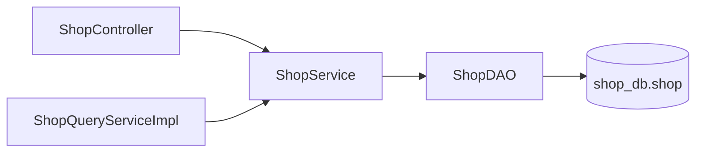

# Shop Service · 店铺应用

负责店铺数据存取，通过 HTTP 提供创建、查询，通过 Dubbo 提供创建、查询、更新、删除。

[项目结构](#项目结构) · [快速开始](#快速开始) · [HTTP 接口](#http-接口) · [Dubbo 接口](#dubbo-接口) · [配置](#配置) · [测试](#测试)

## 项目结构

```text
shop-service/
├── pom.xml                         shop-parent：统一组织模块
├── shop-api/
│   └── src/main/java/com/murto/shop/api/
│       ├── ShopQueryService.java   对外接口
│       └── dto/ShopInfo.java       共享模型
└── shop-server/
    └── src/
        ├── main/java/com/murto/shop/
        │   ├── ShopServiceApplication.java
        │   ├── controller/         HTTP 入口
        │   ├── dto/                HTTP 创建请求
        │   ├── service/            业务逻辑、Dubbo 实现
        │   └── dao/                SQL 执行与结果映射
        ├── main/resources/application.properties
        └── test/java/              业务单测、启动测试
```



## 快速开始

### 环境

| 项目 | 版本 / 默认值 |
| --- | --- |
| JDK / Maven | 21 / 3.9.x，可使用 IDEA 自带 Maven |
| Spring Boot / Dubbo | 3.5.16 / 3.3.6 |
| MySQL | 本地练习使用 8.4，端口 3306 |
| ZooKeeper | 本地练习使用 3.9.7，端口 2181 |
| HTTP / Dubbo 端口 | 8082 / 20881 |

### 数据库

本机已创建 `shop_db.shop`。新环境可在 MySQL 或 DBeaver 中执行：

```sql
CREATE DATABASE IF NOT EXISTS shop_db CHARACTER SET utf8mb4;

CREATE TABLE IF NOT EXISTS shop_db.shop (
    id BIGINT PRIMARY KEY AUTO_INCREMENT,
    name VARCHAR(100) NOT NULL,
    description VARCHAR(500),
    shop_type VARCHAR(30) NOT NULL,
    created_at TIMESTAMP NOT NULL DEFAULT CURRENT_TIMESTAMP
);
```

### 启动

1. 启动 MySQL、ZooKeeper，确认数据库已初始化。
2. 在 IDEA 打开本目录父 `pom.xml`，刷新 Maven。
3. 运行 `shop-server` 中的 `com.murto.shop.ShopServiceApplication`。

如果已配置 `mvn`，在本目录执行：

```bash
# 安装父 POM 与 shop-api，商品应用需要依赖这个接口库
mvn -DskipTests install

mvn -pl shop-server spring-boot:run
```

`shop-api` 是普通接口 JAR，`shop-server` 才是运行中的应用。打包时跳过测试不代表测试已执行，测试方法见后文。

## HTTP 接口

| 方法 | 路径 | 作用 |
| --- | --- | --- |
| POST | `/shop/create` | 创建店铺，成功返回 201 和 ShopInfo |
| GET | `/shop/info?shopId=1` | 根据 ID 查询店铺 |

### 创建

```bash
curl -i -X POST 'http://localhost:8082/shop/create' \
  -H 'Content-Type: application/json' \
  -d '{
    "name": "Murto的店",
    "description": "一家演示店铺",
    "shopType": "PERSONAL"
  }'
```

名称和类型不能为空，名称最多 100、描述最多 500、类型最多 30 个 Java 字符单元。`id` 和 `createdAt` 由数据库生成，创建时不需要传入。重复 POST 会创建不同的店铺。

### 查询

```bash
# shopId 替换为实际创建结果中的 ID
curl 'http://localhost:8082/shop/info?shopId=1'
```

响应示例：

```json
{
  "id": 1,
  "name": "Murto的店",
  "description": "一家演示店铺",
  "shopType": "PERSONAL",
  "createdAt": "2026-11-23T12:08:21"
}
```

当前实现将非法参数与店铺不存在统一转换为 HTTP 400。尚未开放 HTTP PUT、DELETE 入口；更新和删除可通过 Dubbo 调用。

## Dubbo 接口

契约：[ShopQueryService.java](shop-api/src/main/java/com/murto/shop/api/ShopQueryService.java)。

```java
Long createShop(ShopInfo shopInfo);

ShopInfo queryShop(Long shopId);

ShopInfo updateShop(ShopInfo shopInfo);

boolean deleteShop(Long shopId);
```

| 操作 | 约定 |
| --- | --- |
| 创建 | 返回数据库生成的店铺 ID |
| 查询 | 不存在时抛出 IllegalArgumentException |
| 更新 | 按 ID 完整替换名称、描述、类型，返回数据库中的 ShopInfo |
| 删除 | 物理删除；删除成功 true，不存在 false |

更新不修改 `id`、`createdAt`；`description=null` 表示清空描述。更新与回查放在同一个事务中。当前没有实现版本号并发冲突检测。

其他应用依赖：

```xml
<dependency>
    <groupId>com.murto</groupId>
    <artifactId>shop-api</artifactId>
    <version>1.0.0-SNAPSHOT</version>
</dependency>
```

调用方配置相同注册中心并启用 Dubbo 后引用：

```java
@DubboReference(timeout = 3000, retries = 0)
private ShopQueryService shopQueryService;
```

## 配置

配置文件：[application.properties](shop-server/src/main/resources/application.properties)。

| 配置 | 当前值 |
| --- | --- |
| `server.port` | `8082` |
| `dubbo.protocol.port` | `20881` |
| `dubbo.registry.address` | `zookeeper://127.0.0.1:2181` |
| `spring.datasource.url` | `jdbc:mysql://127.0.0.1:3306/shop_db` |
| `spring.datasource.username` | `root` |
| `spring.datasource.password` | 空 |

默认值写在 properties 中，可用 SHOP_DB_URL、DB_USERNAME、DB_PASSWORD、DUBBO_REGISTRY_ADDRESS、SHOP_DUBBO_PORT 环境变量覆盖，也可通过 Spring Boot 命令行参数覆盖。注册中心只用于地址发现，业务 RPC 由调用方直接连接店铺实例。

## 测试

只运行不依赖数据库和注册中心的业务单测：

```bash
mvn -Dtest=ShopServiceTest -Dsurefire.failIfNoSpecifiedTests=false test
```

全量测试：

```bash
mvn test
```

`ShopServiceApplicationTests` 会加载应用上下文和 Dubbo 服务，使用当前配置连接注册中心并开放 `20881`；运行前停止已启动的店铺应用，避免端口冲突。业务单测覆盖更新参数、店铺不存在及删除结果，未替代真实数据库集成验证。

## 相关应用

[账号](../account-service/README.md) · [商品](../goods-service/README.md) · [网关](../gateway-service/README.md)

## 学习复习

[Java 后端开发复习手册](../docs/backend-learning/README.md)按章节解释本项目涉及的 HTTP、Maven、分层、Dubbo、数据库和并发知识。
